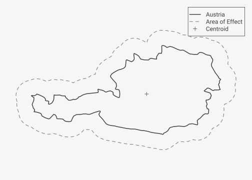
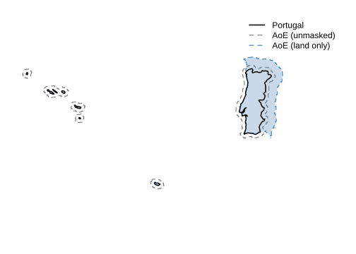

# areaOfEffect

*points inside, near and beyond a region’s border*

<!-- badges: start -->

[](https://CRAN.R-project.org/package=areaOfEffect)
[](https://github.com/gcol33/areaOfEffect/actions/workflows/R-CMD-check.yml)
[](https://app.codecov.io/gh/gcol33/areaOfEffect)
[](https://opensource.org/licenses/MIT)
<!-- badges: end -->

areaOfEffect labels points by where they lie relative to a region, such
as species records inside Austria, in a band around its border, or too
far away to count.

Each point inside the region is labelled core, each point in a buffer
zone around it is labelled halo, and points beyond the buffer are
dropped. Projection, buffering and the point-in-polygon tests run
through [sf](https://r-spatial.github.io/sf/) in one call. The buffer
width comes from the region itself: the default makes the halo area
equal to the core area, so “near the boundary” means the same for
Luxembourg and Brazil. You can then compare core and halo records,
weight them, and decide whether the halo belongs in your analysis.

areaOfEffect supports:

- **Countries by name or your own polygons.**
  [`aoe()`](https://gillescolling.com/areaOfEffect/reference/aoe.html)
  takes a country name or ISO code (`"Austria"`, `"AT"`), several
  countries, an sf polygon, or nothing, in which case it detects the
  countries that contain the points.
- **Coastlines.** `mask = "land"` clips the halo to land, and `area = 1`
  then finds the buffer that makes the halo equal to the core on the
  land that remains.
- **Borders between regions.** `aoe_border()` classifies points by side
  and distance from a line, with zones of equal area on each side, for
  example along an international border.
- **A minimum number of points.** `aoe_expand()` grows the buffer of
  each region until it holds a minimum number of points, within caps on
  area and distance.
- **Balanced samples.** `aoe_sample()` draws a sample stratified by core
  and halo, or by side of a border, when one class dominates.

The default buffer scale, `sqrt(2) - 1`, is the solution of
`(1 + s)^2 - 1 = 1`: the region scaled by `1 + s` has twice its area, so
the halo has the area of the core. Without a mask this holds exactly;
with a mask the buffer is found by a secant search on the clipped area.
[Theory](https://gillescolling.com/areaOfEffect/articles/theory.html)
derives the default and compares it with other choices.

## Installation

``` r
install.packages("areaOfEffect")
```

The development version installs from GitHub:

``` r
# install.packages("pak")
pak::pak("gcol33/areaOfEffect")
```

## Usage

1.  Classify points against a region with `aoe()`.
2.  Count core and halo points per region with `aoe_summary()`.
3.  Keep the classes your analysis needs, or draw a balanced sample with
    `aoe_sample()`.

The input is an sf object of points, or a data frame whose coordinate
columns are detected by their names or set with `coords`, such as
`coords = c("lon", "lat")`. The region is a country name or ISO code, an
sf polygon, or left out.

``` r
library(sf)
#> Linking to GEOS 3.13.1, GDAL 3.11.4, PROJ 9.7.0; sf_use_s2() is TRUE
library(areaOfEffect)

observations <- data.frame(
  id  = c("A", "B", "C", "D"),
  lon = c(14.5, 15.2, 16.8, 20.0),
  lat = c(47.5, 48.1, 47.2, 48.5)
)
result <- aoe(observations, "Austria")
result
#> Area of Effect Result
#> ─────────────────────
#> Points:   3 (2 core, 1 halo)
#> Supports: 1
#> Scale:    0.414 (multiplier 1.41, theoretical halo:core 1.00)
#> 
#> Simple feature collection with 3 features and 4 fields
#> Geometry type: POINT
#> Dimension:     XY
#> Bounding box:  xmin: 14.5 ymin: 47.2 xmax: 16.8 ymax: 48.1
#> Geodetic CRS:  WGS 84
#>   point_id support_id aoe_class id          geometry
#> 1        1        225      core  A POINT (14.5 47.5)
#> 2        2        225      core  B POINT (15.2 48.1)
#> 3        3        225      halo  C POINT (16.8 47.2)
```

Points A and B lie in Austria and are core, point C lies in the buffer
zone east of the border and is halo, and point D, in Slovakia beyond the
buffer, is dropped. The result is an sf object, so it goes straight into
sf and ggplot2 workflows.

<p align="center">


</p>

``` r
aoe_summary(result)
#>   support_id n_total n_core n_halo prop_core prop_halo
#> 1        225       3      2      1 0.6666667 0.3333333
```

## Buffers on land

The default buffer extends into anything around the region, including
the sea, where terrestrial records cannot occur. `mask = "land"` clips
the halo to land, and `area = 1` solves for the buffer that makes the
halo equal to the core after clipping:

``` r
aoe(df, "Portugal", mask = "land", area = 1, largest_polygon = FALSE)
```

`largest_polygon = FALSE` keeps Portugal’s islands, which the default
drops in favour of the largest polygon.

<p align="center">


</p>

## Buffer size

`scale` sets the halo size relative to the core. The halo:core area
ratio is `(1 + scale)^2 - 1`:

| Scale                   | Halo:core area |
|-------------------------|----------------|
| `sqrt(2) - 1` (default) | 1:1            |
| `0.5`                   | 1.25:1         |
| `1`                     | 3:1            |

[Theory](https://gillescolling.com/areaOfEffect/articles/theory.html#the-scale-parameter)
explains when another scale suits an analysis.

## Documentation

Start with [Quick
Start](https://gillescolling.com/areaOfEffect/articles/quickstart.html):
points classified against a country, against your own polygons and
several regions, and with a coastline mask.

- [Theory](https://gillescolling.com/areaOfEffect/articles/theory.html):
  why the default buffer has the area of the core, the buffer and stamp
  methods, and masks.
- [Full reference](https://gillescolling.com/areaOfEffect/reference/):
  every function, grouped by job.

## Getting help

Questions and bug reports go to the [GitHub
issues](https://github.com/gcol33/areaOfEffect/issues). A bug report is
easiest to act on with a small reproducible example, for instance made
with [reprex](https://reprex.tidyverse.org/).

## Support

> “Software is like sex: it’s better when it’s free.” — Linus Torvalds

I’m a PhD student who builds R packages in my free time because I
believe good tools should be free and open. I started these projects for
my own work and figured others might find them useful too.

If this package saved you some time, buying me a coffee is a nice way to
say thanks. It helps with my coffee addiction.

[](https://buymeacoffee.com/gcol33)

## Acknowledgements

The projection, buffering and point-in-polygon tests run on
[sf](https://r-spatial.github.io/sf/).

## License

areaOfEffect is licensed under MIT.

## Citation

``` text
Colling G (2026). _areaOfEffect: Classify Points by Distance to Polygon
Boundaries_. doi:10.32614/CRAN.package.areaOfEffect
<https://doi.org/10.32614/CRAN.package.areaOfEffect>. R package version
0.2.5, <https://gillescolling.com/areaOfEffect/>.
```

BibTeX:

``` bibtex
@Manual{colling2026areaofeffect,
  title = {areaOfEffect: Classify Points by Distance to Polygon Boundaries},
  author = {Gilles Colling},
  year = {2026},
  note = {R package version 0.2.5},
  url = {https://gillescolling.com/areaOfEffect/},
  doi = {10.32614/CRAN.package.areaOfEffect},
}
```

Download the citation as
[BibTeX](https://gillescolling.com/areaOfEffect/areaOfEffect.bib) or
[RIS](https://gillescolling.com/areaOfEffect/areaOfEffect.ris).
